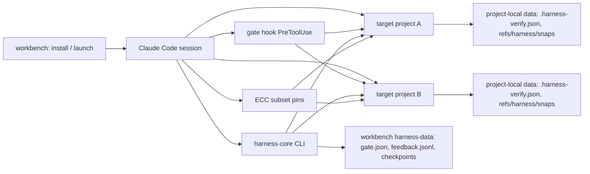

# AI Workbench

*A lightweight, governed, on-demand engineering workbench for Claude Code.*

`v0.1.0-preview.3` (Public Preview) — [release](https://github.com/zhongli369/ai-workbench/releases/tag/v0.1.0-preview.3) · [中文](README.zh-CN.md)

| Badge | Status |
|---|---|
| CI (contracts + static + CLI smoke) | [](https://github.com/zhongli369/ai-workbench/actions/workflows/ci.yml) |
| Supply-chain security scan | [](https://github.com/zhongli369/ai-workbench/actions/workflows/security.yml) |
| Release (preview) | [](https://github.com/zhongli369/ai-workbench/releases/tag/v0.1.0-preview.3) |
| License | [](LICENSE) |

---

## 1. What this is

**One sentence.** AI Workbench is a thin, install-once workspace layer on top
of Claude Code — not another skills mega-pack — that operates **many projects
from one session**, loads expert capabilities **per task instead of resident**,
and routes irreversible commands through a **three-tier gate**.

**The pain it fixes.**

1. Juggling several repositories means re-establishing context in every
   session; a single launch should serve any project.
2. Capability packs charge every prompt for rules you do not need today;
   heavy rules should load only when a task needs them.
3. One mistaken irreversible command can ruin a day's work; it should be a
   deliberate, gated act instead.

**How it honestly splits from what already exists** (split by origin):

| | native Claude Code | everything-claude-code (ECC) | AI Workbench |
|---|---|---|---|
| Edit / test / ship inside one project | ✔ (that is CC itself) | | |
| 60+ agents / 240+ skills catalog | | ✔ (upstream project) | |
| Curated ECC subset, on-demand not resident | | | ✔ **(30+16+14)** skills/agents/commands, pinned |
| One workspace operating many projects | | | ✔ (self-developed) |
| Cross-session failure memory + repeat-error oracle *(experimental)* | | | ✔ (self-developed; in-vivo gain unproven) |
| FAST / STANDARD / DEEP / RECOVERY cost policy | | | ✔ (self-developed, guidance) |
| Three-tier gate for irreversible commands | | | ✔ (self-developed, enforced) |

**Honest capability classification.** Claims in this README use these four
grades, and nothing weaker is promoted to something stronger:

| Grade | Examples | Nature |
|---|---|---|
| **Natively automatic** | CC's own edit / test / git | mechanism |
| **Wired trigger** | gate `PreToolUse` hook, `--add-dir` loads a target project's `CLAUDE.md`, `claudeMdExcludes` exemption | mechanism — active once installed |
| **Task-grade on-demand** | ECC skills/agents, every `harness-core` CLI command | convention-driven invocation |
| **Explicit authorization** | gate `ENFORCE` interception of high-risk commands, release publishing | mechanism — enforced |

Protocol written in the workspace `CLAUDE.md` — task grading (FAST/STANDARD/DEEP),
"verify *before* claiming done", fail-triggered failure-store queries — is
**guidance** (约定/指引), not a system-enforced guarantee. Only mechanisms
(the gate hook, `ENFORCE` mode, CLI exit codes) are enforced.

## 2. What you get (delivered capabilities)

| # | Capability | How it is triggered |
|---|---|---|
| 1 | One launch, many projects | Wired: launcher sets `CLAUDE_CODE_ADDITIONAL_DIRECTORIES_CLAUDE_MD=1`; `/add-dir` or launch `--add-dir <project>` loads a target project's `CLAUDE.md`; absolute paths / `git -C` work across projects |
| 2 | Correct rules per target project | Wired: workspace `claudeMdExcludes: ["**/.claude/rules/ecc/**"]` stops global rule packs from shadowing a project's own `CLAUDE.md` |
| 3 | Curated ECC subset on demand | Task-grade: `Skill` / agent loading per task — 30 skills / 16 agents / 14 commands, pinned `vendor/ecc/` |
| 4 | `harness-core` CLI (stdlib-only, deterministic, 204 contracts) | On-demand: `feedback` · `report` · `gate` · `telemetry` · `checkpoint` · `plan` · `verify` · `snap` |
| 5 | Cross-session failure memory **(experimental)** | Fail-triggered: `feedback record` writes a lesson; `feedback query` is consulted only when a real failure is hit — never by default on a fresh task (mechanism contract-verified; in-vivo gain unproven) |
| 6 | Three-tier irreversible-command gate | Wired: single `PreToolUse` hook (`hooks/harness_gate.py`); mode via `gate mode` |
| 7 | Post-edit verification loop | On-demand: `verify run` / `verify status`; config `.harness-verify.json` lives in the target project |
| 8 | Workspace file snapshots | On-demand: `snap save/list/diff/verify/restore/prune`; restore is always dry-run first |
| 9 | DEEP-mode planning scaffold | On-demand: `plan "<task>"`; never auto-injected, never a required step |
| 10 | Versioned task-state checkpoints | On-demand: `checkpoint begin/save/load/replay/verify/list` |
| 11 | Release supply-chain gate | CI-only: `trivy` fs scan in `.github/workflows/security.yml` (push main / `v*` tags / PR-to-main block; schedule + non-main PRs audit) |
| 12 | Complexity-matched cost policy | Guidance: FAST / STANDARD / DEEP / RECOVERY task grading from the workspace `CLAUDE.md` |

## 3. Quick install

Requirements: **Python ≥ 3.10** and the **Claude Code CLI**.
Windows is the primary tested platform; Linux/macOS exercise the POSIX code
paths in CI (Python 3.10–3.12, three OSes). `harness-core` is stdlib-only —
no `pip install` is needed beyond Python itself.

```bash
git clone https://github.com/zhongli369/ai-workbench.git
cd ai-workbench
python tools/workbench.py doctor            # preflight, never mutates
python tools/workbench.py install --yes     # standalone by default
python tools/workbench.py launch            # prints the exact launch command
```

- `doctor` reports PASS/WARN/FAIL and never mutates anything.
- `install` is idempotent and dry-run-able; it writes **only** into its target
  directory and records every file it owns in `install-manifest.json`. Scopes:
  `standalone` (default, one directory) · `project` (`.ai-workbench/` inside a
  repo) · `user` (prints manual global-config steps — never edits your global
  config silently).
- Point every subcommand at a non-default install location with the global
  `--target` flag (place it **before** the subcommand: `--target <dir> install`);
  omitting it uses the platform data directory (on Windows
  `%LOCALAPPDATA%\ai-workbench`, on POSIX `$XDG_DATA_HOME/ai-workbench`).
- `launch` prints the exact `claude --settings …` command (via
  `launch/workbench.ps1` on Windows or `launch/workbench.sh` on POSIX).

An installed root looks like this:

```
<workbench>/                  ← your installed workbench root (--target)
├─ CLAUDE.md                  ← session policy: cost policy, gate rules, capabilities
├─ .claude/                   ← workspace settings: PreToolUse gate hook, claudeMdExcludes, ECC subset
├─ harness-core/              ← stdlib, 204 contracts toolkit (feedback · gate · plan · checkpoint · verify · snap)
├─ hooks/harness_gate.py      ← the single PreToolUse gate hook
├─ vendor/ecc/                ← everything-claude-code pin 2.0.0-rc.1 (MIT, see NOTICE)
├─ capabilities/              ← registry + wiring for the 16 on-demand capabilities
├─ harness-data/              ← your local data: gate.json, feedback.jsonl, checkpoints
└─ install-manifest.json      ← exactly the files this install owns
```

Uninstall removes only files the manifest owns, preserves your data unless you
opt out, and never touches your global Claude configuration:

```bash
python tools/workbench.py uninstall --yes           # keeps feedback/checkpoints
python tools/workbench.py uninstall --yes --purge-data
```

## 4. Five-minute quickstart

A real shortest path, all offline:

```bash
python tools/workbench.py doctor
python tools/workbench.py install --yes
python tools/workbench.py launch        # run the exact command it prints
```

In the session that opens:

1. Point at any project with `/add-dir <project>` (or just name its path).
2. Ask something small and concrete — *"fix the failing test in <project>"* —
   and note that small fixes skip planning, agents, and bookkeeping (FAST).
3. Use the harness CLI to record one lesson (commands below).
4. Deliberately trigger a guardrail: tell the session *"git push"*. In the
   default `AUDIT` mode the gate logs the decision; switch to enforcement with
   `python harness-core/harness/cli.py gate mode --set enforce`.
5. Open a **new** session and query the failure store back.

```bash
# record a verified lesson (session 1)
python harness-core/harness/cli.py feedback record \
  --project-id <project> --cause permission_tool_mismatch \
  --summary "allowedTools listed Bash(python:*) but the model used PowerShell" \
  --source human-verified --confidence 1.0

# consult the store before re-debugging (session 2)
python harness-core/harness/cli.py feedback query \
  --project-id <project> --keyword allowedTools --json

# switch the gate to enforcement
python harness-core/harness/cli.py gate mode --set enforce
```

> The commands above are repo-relative (you run them from the clone you
> installed with). Once installed, the same harness CLI lives at
> `<workbench>/harness-core/harness/cli.py`, where `<workbench>` is your
> install root — the commands work identically from any directory.

## 5. Multi-project workspace

One installed workbench, many projects, no re-setup per project:

- **Launch once.** The workbench session is your entry. Operate any project
  with absolute paths, `git -C <project>`, or `python -m pytest <project>`.
- **The target project's own rules load in its own tree.** The launcher sets
  `CLAUDE_CODE_ADDITIONAL_DIRECTORIES_CLAUDE_MD=1`; `/add-dir <project>` (or
  launch passthrough `--add-dir <project>`) makes Claude Code read that
  project's `CLAUDE.md`. Demo 1 shows two projects with *contradicting* rules
  staying isolated (see [docs/demos.md](docs/demos.md)).
- **`claudeMdExcludes` keeps global rule packs from shadowing a project.**
  The workspace settings exempt `**/.claude/rules/ecc/**`, so a project's own
  conventions win inside its tree while the workbench's global tools still apply.
- **Default MCP is zero, enforced at launch.** The launcher passes
  `--strict-mcp-config`, so global/user MCP registrations cannot silently add
  hundreds of tool schemas to the resident context. The workbench's own
  on-demand `.mcp.json` is loaded only when it exists. Use
  `python tools/context_audit.py` to measure the actual schema cost from a
  transcript. This applies to sessions started through `workbench launch`;
  a direct `claude` invocation is outside the launcher and still loads
  user-level MCP.
- **Project-local harness data.** `snap` snapshots are stored as git refs in
  the **target repository** (`refs/harness/snaps/`), and the verify config
  (`.harness-verify.json`) lives in the task directory — pass `--cwd <project>`.
- **No disk scanning, no default write access.** Project identification comes
  from the user or a project cheat sheet — the workbench never scans your disk
  for projects. The only `PreToolUse` hook is the Bash-scoped gate; no script
  silently edits a target project. A project whose `CLAUDE.md` a session loads
  gets its rules as context and **cannot** override the global security bottom
  line (no hardcoded secrets, input validation at boundaries, explicit error
  handling, gated irreversible commands).

## 6. On-demand intelligence: cost policy + 16 capabilities

The workspace `CLAUDE.md` grades every task (guidance, not enforcement —
nobody hard-stops a FAST task from using a DEEP capability):

- **FAST** — single-file small fix / query / explicit instruction: do it
  directly; no agents, no global scan, no failure-store query by default,
  run only the relevant tests, no bookkeeping.
- **STANDARD** — multi-file / new feature / bugfix: load the relevant skill
  (tdd, language patterns), verify after changes, consult the failure store
  **only when a real failure is hit** (fail-triggered).
- **DEEP** — architecture / high-risk / cross-system: plan first (`plan` or a
  planner), define acceptance criteria, may query history and call expert
  agents, then review (code-reviewer, +security-reviewer on sensitive paths),
  full test evidence, checkpoints for long-horizon work.
- **RECOVERY** — only when genuinely stuck (repeating same error, no progress,
  missing external state): fail-triggered history query first, shrink the
  problem back to the main agent. A single ordinary test failure never
  triggers a recovery cascade, and recovery never disables the gate.

The **16 on-demand capabilities** (`python tools/workbench.py capability list`):

| Capability | Origin | Trigger | Default |
|---|---|---|---|
| `harness-oracle` — failure-memory oracle | self | fail-triggered `feedback query`, never by default | on |
| `harness-gate` — three-tier gate | self | every Bash call in interactive sessions (hook) | on |
| `ecc-skills` — curated ECC skills | ECC pin | `Skill` tool per task need | on |
| `ecc-agents` — curated ECC agents | ECC pin | STANDARD+/DEEP tasks only | on |
| `cost-policy` — FAST/STANDARD/DEEP/RECOVERY | self | model self-classifies per task (guidance) | on |
| `harness-plan` — deterministic phase+AC scaffold | self | DEEP tasks, explicit `plan` invocation | on |
| `harness-checkpoints` — versioned task-state checkpoints | self | long-horizon work: `checkpoint begin/save/load/verify` | on |
| `harness-verify` — post-edit verification loop | extract:aider | `verify run|status` (config in target repo) | on |
| `harness-snap` — git-backed file snapshots | extract:cline | `snap save/list/diff/verify/restore/prune` | on |
| `supply-chain-gate` — release trivy scan | integrate:trivy | CI only: push main / `v*` tags / PR-to-main (blocking) | on |
| `repomix` — repo-map / context packing | external-optional | large-repo orientation when built-in search is insufficient | off |
| `agent-browser` — real UI acceptance | external-optional | launch app, click, DOM/console/network asserts, screenshots | off |
| `superpowers` — methodology pack (TDD/debugging) | external-plugin | user installs via `/plugin install superpowers@claude-plugins-official` | off |
| `superpowers-systematic-debugging` — root-cause-first debugging skill | extract:superpowers | non-obvious failure: unexplained bug or a fix that didn't hold | off |
| `playwright-mcp` — browser server (on-demand, pinned) | external-optional | only when a persistent browser session is required | off |
| `codex-review` — on-demand read-only second opinion (codex-cli) | user-installed tool (skill-file) | explicit ask: "用 codex 审查" / "codex 第二意见" / "second opinion with codex"; one bounded review per ask | off |

`capability enable <id>` / `capability disable <id>` / `capability status
<id>` act per wiring type; external capabilities are **never auto-installed**
— `capability doctor` prints the manual steps.

### 6.1 Browser via Playwright MCP (mcp-config wiring, v1.2)

`capability enable playwright-mcp` wires **one managed entry** —
`aiwb-playwright`, `npx -y @playwright/mcp@0.0.83 --headless --isolated
--browser chromium` — into the target project's `.mcp.json` (created only if
absent), plus a managed SKILL.md that teaches the model how to drive the
browser server. Gate order: mutex vs `agent-browser` → **fail-closed offline
readiness gate** (node, npm, the pinned package resolvable via npx cache or a
project-local install, a browser for the configured channel — any of these
missing ⇒ enable refuses and prints the exact manual install steps; the
workbench **never auto-installs** external software) → write entry → live
stdio MCP handshake (`initialize` + `tools/list`). A failed handshake is a
WARN with the honest state, never a hard failure.

- **Scope**: the entry lives in the *project's* `.mcp.json`, so the server
  appears for Claude Code sessions in that project only — and still requires
  project-level approval (`/mcp`) before tools are callable. Nothing is
  written to global `~/.claude` config.
- **Status**: `capability status playwright-mcp` probes live and reports one
  of four states: `not-installed` / `installed-not-enabled` /
  `enabled-not-connected` / `connected-tested`.
- **Close**: `capability disable playwright-mcp` removes only the managed
  entry (user entries in the same file are preserved byte-wise); an empty
  `.mcp.json` the workbench itself created is removed. `workbench uninstall`
  sweeps every managed entry + SKILL.md, each gated on an intact
  `<!-- aiwb-managed:... -->` marker — a file whose marker you stripped is
  left alone.
- **Limits (honest)**: desktop-browser automation ≠ real mobile devices —
  the responsive-layout test narrows the viewport and asserts layout, it does
  not claim Android fidelity; `npx` fetches the pinned package into the npm
  cache on first use (needs network once, `@playwright/mcp@0.0.83` is pinned
  — never `latest`); the default `chromium` channel needs `npx playwright
  install chromium` or a `PLAYWRIGHT_BROWSERS_PATH` with the browser; a
  missing browser refuses enable with zero writes unless you explicitly
  accept it via `capability enable playwright-mcp --allow-missing-browser`.
- **CLI duel (REJECTED)**: a 2026-10-16 duel against `@playwright/cli@0.1.22`
  (B1–B4 real-browser tasks) reached only parity — 4/4 PASS on both sides —
  and was REJECTED (verdict C): `@playwright/mcp@0.0.83` stays the only
  integrated browser path and the CLI is not wired. No token-savings claim
  is made — no model token logs were collected (evidence:
  `docs/decisions/2026-10-16-playwright-cli.md`).

### 6.2 Root-cause-first debugging skill (skill-file wiring, pure content)

`capability enable superpowers-systematic-debugging` writes a marked
SKILL.md (adapted port of superpowers' systematic-debugging skill, pin
`bb92a77`, MIT text in-file) into `.claude/skills/aiwb-...` of the target.
Pure content — no external tool, no hook, no auto-install; the
template-existence check is the enable-time gate. The skill is a boundary
that fires only on non-obvious failures (symptom ≠ root cause, a fix that
didn't hold, cross-component breakage) and stops after 3 failed
fix-attempts. Rejected as duplicating curated ECC skills: superpowers'
test-driven-development and requesting-code-review (evidence in
`docs/decisions/2026-10-15-superpowers.md`).

### 6.3 Codex second opinion (skill-file wiring, default OFF)

`capability enable codex-review` writes a managed SKILL.md teaching one
thing: how to ask the **user-installed** OpenAI codex-cli for a bounded,
read-only second opinion. Hard boundaries:

- **Default OFF, zero hooks, zero default model calls.** Codex appears only
  when the user explicitly asks ("用 codex 审查" / "codex 第二意见" /
  "second opinion with codex") on a bounded target — one commit, one branch
  diff, or one file; one bounded review per ask. This is **not** automatic
  dual-model collaboration.
- **Never auto-installed.** The workbench does not install or upgrade Codex;
  if your machine has no codex-cli, enable refuses. Health check is a
  `cli-version` probe (path + `--version` prefix `codex-cli`) because the
  PATH `codex` on the dev machine is an unrelated npm static-site
  generator — a same-named decoy is not accepted.
- **Read-only is enforced by the CLI itself** (`-c sandbox_mode=read-only`
  plus `--ephemeral`), not by a polite prompt; a run must leave
  `git status --short` empty.
- **Costs and data**: a review sends the bounded diff/file content to your
  configured Codex provider and consumes your own Codex quota/account.
- Verified for real on 2026-10-16: one bounded review of a gate-hardening
  commit (exit 0, ~7 min, 4 substantive findings — two were real gate
  regressions, since fixed with regression contracts), so this is a proven
  path, not "MODEL E2E UNVERIFIED". Evidence:
  `docs/decisions/2026-10-16-codex.md`.

## 7. snap & verify: safe undo, honest completion

**`harness snap`** — git-backed file snapshots whose restore can never blow
away unrelated work:

```bash
python harness-core/harness/cli.py snap save --cwd <project> --exec demo
python harness-core/harness/cli.py snap list --cwd <project>
python harness-core/harness/cli.py snap diff <snap_id> --cwd <project>
python harness-core/harness/cli.py snap verify <snap_id> --cwd <project>
python harness-core/harness/cli.py snap restore <snap_id> --cwd <project>          # dry-run
python harness-core/harness/cli.py snap restore <snap_id> --cwd <project> --apply  # explicit
python harness-core/harness/cli.py snap prune --cwd <project> --exec demo --keep 5
```

> `<snap_id>` comes from `snap list`; `<project>` is the target repo's path.
> Inside an installed workbench the CLI is `<workbench>/harness-core/harness/cli.py`.

- `restore` is **dry-run by default**: it prints the plan and writes nothing;
  exit `0` only for a clean plan, exit `1` on conflict/blocked/error
  (script-safe fail-closed semantics).
- `--apply` writes **only** snapshot-managed files, creates a rescue git ref
  first, and fails closed if the worktree has concurrent edits. It never uses
  `reset --hard` or `clean -fd`.
- The gate is consulted: `AUDIT` logs, `ENFORCE` may block (pass `--token`).
- `snap verify <snap_id>` exit `1` means the manifest/ref/commit chain is broken.

**`harness verify`** — a bounded, gated post-edit verification loop:

```bash
python harness-core/harness/cli.py verify run    --exec <id> --stage <stage> --cwd <project>
python harness-core/harness/cli.py verify status --exec <id>
```

- `verify run` exit codes: `0` pass · `1` fail/refused/exhausted ·
  `2` bad input · `3` skipped (nothing configured — distinct from pass).
- `verify status` exits `0` **only** when done is mechanically claimable
  (`can_claim_done`), `1` otherwise; tampering with the evidence log after a
  pass flips it back to `1`.
- Commands come from `.harness-verify.json` in the task directory
  (`commands`, `timeout_s`, `max_reflections`), or from an explicit gated
  `--cmd` path: `AUDIT` logs and allows, `ENFORCE` needs `--token`, `DISABLED`
  refuses.
- Honesty: `can_claim_done` is **advisory**. The harness ships **no** hook
  that forces a model to consult it — the single `PreToolUse` hook is the
  gate. What the CLI can do is make a stage that has not passed **impossible
  to claim as done** through its own exit contract.

## 8. Security & reliability

- **Three-tier gate** (`DISABLED` / `AUDIT` / `ENFORCE`):
  - `DISABLED` — the gate does nothing.
  - `AUDIT` — records and prompts; **this is observability, not protection**.
  - `ENFORCE` — configured high-risk patterns (`git push`, `git reset --hard`,
    `git clean -f`, `rm -rf`, publish/deploy commands) are blocked unless
    pre-approved; an unreadable gate config **fails closed**.
- **One-time approvals.** `gate approve --once --action "git push origin main"`
  issues a single-use token (`awt-…`, SHA-256 stored, TTL-bound) consumed by
  exactly one matching command; the raw token is printed once and never written
  to the audit log.
- **Single hook.** The only `PreToolUse` hook is the Bash-scoped
  `hooks/harness_gate.py` — no daemon, no background service, **zero default
  model calls** (codex-review and the skill quality gate call no model
  unless explicitly invoked).
- **`claude --print` caveat.** Non-interactive `claude --print` does not
  execute `PreToolUse` hooks (verified 2026-10 on CC 2.1.x), so `ENFORCE`
  applies to interactive sessions.
- **Zero network at install.** Install copies files; nothing is downloaded
  at runtime. The supply-chain gate is a **CI-only** `trivy` fs scan with the
  binary pinned by SHA-256 and GitHub Actions pinned by commit SHA.
- **Byte-level restore.** `snap` restore verifies SHA-256s; a restore returns
  the tree byte-identical to the snapshot, and concurrent edits conflict
  closed instead of being merged or destroyed.
- **Battle-tested.** `tests/` carries 24 battle tests across 5 scenarios
  (`tests/battle/`) that exercise the **real** CLI against real filesystems,
  real git, and real subprocesses: malformed target dirs (S1), broken config
  fail-closed (S2), agent-pretending-to-finish (S3), cross-session resume (S4),
  edge filesystems (S5).
- **FAST audit, 8/8** (verified): no resident service, no auto-plan injection,
  no snapshot storm, exactly one gate hook, zero network at install,
  idempotent reinstall, owns-only uninstall, and machine-path hygiene
  (`tools/check_hygiene.py`).

## 9. Architecture



Roles:

- **Install/launch** (`tools/workbench.py`) puts a workspace under `<workbench>`
  and launches Claude Code against it with a `--settings` file that wires the
  gate hook, `claudeMdExcludes`, and `CLAUDE_CODE_ADDITIONAL_DIRECTORIES_CLAUDE_MD=1`.
- **Claude Code session** is the runtime; the workspace `CLAUDE.md` is
  guidance, the hook + CLI are mechanisms.
- **Gate hook / harness-core CLI / ECC subset** are the three load-bearing
  columns — mechanism (hook), mechanism (CLI + exit contracts), and
  convention (on-demand skill/agent loading).
- **Target projects A/B** are never modified by install; `.harness-verify.json`
  and snap refs belong to the project that owns them, and harness bookkeeping
  (`feedback`, `checkpoint`, `gate`) lives in the workbench's `harness-data/`.

## 10. Real evidence

- **483 offline contracts** = **204 harness-core** + **279 tests** (240
  top-level — incl. 48 mcp-config wiring in `tests/test_wiring_mcp.py`, 29
  skill-quality in `tests/test_skills_quality.py`, 28 security-scan in
  `tests/test_security_scan.py` + 24 battle under `tests/battle/` + 15
  multi-project isolation under `tests/multiproj/`;
  this exact number is verified live by
  `tools/check_docs_drift.py` against the pytest collection; the core is
  stdlib, 204 contracts and deterministic).
- **24 battle tests** under `tests/battle/` (5 scenarios) hit the real CLI
  end-to-end; they are included in the 279 tests above.
- **CI** — [ci.yml](.github/workflows/ci.yml): contracts across
  `windows-latest`/`ubuntu-latest`/`macos-latest` × Python 3.10–3.12, plus
  static checks (hygiene, docs-drift gate, frozen public surface) and CLI
  smoke. **Security** — [security.yml](.github/workflows/security.yml):
  `trivy` fs scan with honest exit semantics (0 clean / 1 findings / 2 usage /
  3 infra-failure), release paths always blocking.
- **Demos** — three reproducible, offline-verifiable demonstrations in
  [docs/demos.md](docs/demos.md): [Demo 1 — one workspace, two conflicting
  projects](docs/demos.md#demo-1) · [Demo 2 — a failure recorded in session A
  is reused in session B](docs/demos.md#demo-2) · [Demo 3 — multi-file feature
  with on-demand capabilities](docs/demos.md#demo-3).
- **Release** — `v0.1.0-preview.3` published as a GitHub prerelease
  [here](https://github.com/zhongli369/ai-workbench/releases/tag/v0.1.0-preview.3),
  with a `zip` and a `.sha256` sidecar. Verify the artifact:
  `Get-FileHash ai-workbench-0.1.0-preview.3.zip -Algorithm SHA256` (or
  `sha256sum`) and compare with the sidecar.

## 11. Limitations & boundaries (Public Preview, honest)

- **The failure oracle is experimental and its in-vivo retrieval benefit is
  unproven.** Mechanism (record → store → fail-triggered query → project
  isolation) is contract-verified; controlled runs showed arms **never**
  querying it (the model self-diagnosed). Its plausible domain is failures
  whose root cause is not readable anywhere in the project
  (environment/config/history). Do not treat it as a guarantee.
- **`can_claim_done` is advisory.** It is a mechanical CLI state that `verify
  status` reports; no hook forces a model to consult it. The admission that a
  stage is verifiable does not prove the work is correct.
- **Windows is the primary tested platform.** Linux/macOS run the POSIX code
  paths in CI; fresh-install acceptance on those platforms is not yet
  human-verified.
- **Preview API.** `v0.1.0-preview.*` surfaces can change without a major
  bump; `docs/surface.json` freezes the CLI/schema surface — additive changes
  are free, breaking changes require a major release.
- **ECC is pinned.** The bundled snapshot is `v2.0.0-rc.1`
  (commit `928076cc`, 2026-05-25); upstream fixes published after the pin are
  not included (see `NOTICE`).
- **Gate scope.** `ENFORCE` applies to interactive sessions; `claude --print`
  skips `PreToolUse` hooks (verified on CC 2.1.x).
- **First launch may prompt.** Claude Code's own trust confirmation in a fresh
  directory is yours to answer; the installer never bypasses it.
- **Policy is guidance.** Fast/STANDARD/DEEP grading and "verify before done"
  are conventions in the workspace `CLAUDE.md`, not enforced by a hook.

## 12. Contributing, docs & license

Issues and PRs are welcome. The project values **evidence over enthusiasm**:
changes ship with contracts, measurements, or both. See
[CONTRIBUTING.md](CONTRIBUTING.md). Near-term roadmap (platform acceptance,
bench batch 2, ECC pin refresh) is tracked as gates in
[RELEASE_READINESS.md](RELEASE_READINESS.md).

Maintainer gates that keep this README honest:
[docs/claims.json](docs/claims.json) (release claims verified live),
[docs/surface.json](docs/surface.json) (frozen public CLI/schema surface), and
[docs/incidents/registry.json](docs/incidents/registry.json) (named historical
failures locked as permanent regression tests).

Related docs: [中文 README](README.zh-CN.md) ·
[NOTICE](NOTICE) (third-party attribution) · [SECURITY.md](SECURITY.md)
(threat model & reporting) · [CHANGELOG.md](CHANGELOG.md) (release history) ·
[harness-core/README.md](harness-core/README.md) (the toolkit, usable
standalone) · [docs/ARCHITECTURE.md](docs/ARCHITECTURE.md) ·
[docs/POLICY_VERIFICATION.md](docs/POLICY_VERIFICATION.md).

## License

MIT for this distribution's own code. everything-claude-code is MIT by its
respective authors — see `vendor/ecc/LICENSE` and `NOTICE`.
