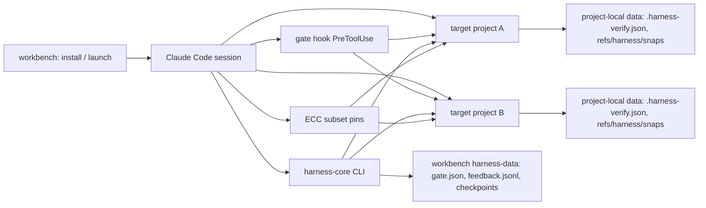

# AI 工作台

*面向 Claude Code 的轻量、受治理、按需增强的软件工程工作台。*

`v0.1.0-preview.3`（Public Preview）— [发布](https://github.com/zhongli369/ai-workbench/releases/tag/v0.1.0-preview.3) · [English](README.md)

| 徽章 | 状态 |
|---|---|
| CI（契约 + 静态检查 + CLI 冒烟） | [](https://github.com/zhongli369/ai-workbench/actions/workflows/ci.yml) |
| 供应链安全扫描 | [](https://github.com/zhongli369/ai-workbench/actions/workflows/security.yml) |
| 发布（预览版） | [](https://github.com/zhongli369/ai-workbench/releases/tag/v0.1.0-preview.3) |
| 许可证 | [](LICENSE) |

---

## 1. 这是什么

**一句话。** AI 工作台是架在 [Claude Code](https://claude.com/claude-code) 之上的一层薄工作台 — 不是又一个 Skills 大合集 — 它在一个会话里**操作任意项目**、把专家能力**按任务而非常驻**地加载、并让不可逆命令走**三档闸门**。

**它解决的痛点。**

1. 多个仓库来回切换, 每次会话都要重建上下文; 一次启动应当服务任意项目。
2. 能力包让每条提示词都为今天用不上的规则付费; 重型规则应该只在任务需要时加载。
3. 一条误发的不可逆命令可能毁掉一天的工作; 它应当是一个深思熟虑、受闸门约束的动作。

**与既有事实的诚实分界**（按来源拆分）:

| | 原生 Claude Code | everything-claude-code (ECC) | AI 工作台 |
|---|---|---|---|
| 单项目内改代码 / 测试 / 交付 | ✔（CC 本身） | | |
| 60+ agents / 240+ skills 目录 | | ✔（上游项目） | |
| 精选 ECC 子集, 按需非常驻 | | | ✔ **(30+16+14)** skills/agents/commands, 已 pin |
| 一个工作台操作多项目 | | | ✔（自研） |
| 跨会话失败记忆 + 重错 oracle *(实验性)* | | | ✔（自研；in-vivo 收益未证明） |
| FAST / STANDARD / DEEP / RECOVERY 成本策略 | | | ✔（自研, 指引性质） |
| 不可逆命令三档闸门 | | | ✔（自研, 强制性质） |

**诚实的能力分级。** 本文档中的每一项主张都属于以下四级之一, 且不会把更弱的说法包装成更强的保证:

| 分级 | 例子 | 性质 |
|---|---|---|
| **原生自动** | CC 自带的编辑 / 测试 / git | 机制 |
| **已接通触发** | gate `PreToolUse` hook、`--add-dir` 加载目标项目 `CLAUDE.md`、`claudeMdExcludes` 豁免 | 机制 — 安装即生效 |
| **任务级按需** | ECC skills/agents、`harness-core` CLI 各子命令 | 约定驱动的调用 |
| **显式授权** | gate `ENFORCE` 拦截高危命令、release 发布 | 机制 — 强制 |

写在工作台 `CLAUDE.md` 里的协议 — 任务分级（FAST/STANDARD/DEEP）、"验证后才算完成"、失败触发才查失败史 — 属于**指引**（约定/指引), 而非系统强制的保证。只有机制（闸门 hook、`ENFORCE` 模式、CLI 退出码）才是强制的。

## 2. 已交付能力（真实清单）

| # | 能力 | 触发方式 |
|---|---|---|
| 1 | 一次启动, 多项目 | 已接通: 启动器设置 `CLAUDE_CODE_ADDITIONAL_DIRECTORIES_CLAUDE_MD=1`; `/add-dir` 或 launch 透传 `--add-dir <project>` 加载目标项目 `CLAUDE.md`; 绝对路径 / `git -C` 跨项目操作 |
| 2 | 目标项目规则正确加载 | 已接通: 工作区 `claudeMdExcludes: ["**/.claude/rules/ecc/**"]` 防止全局规则包遮蔽项目自己的 `CLAUDE.md` |
| 3 | 精选 ECC 子集按需调用 | 任务级: 按任务加载 `Skill`/agent — 30 skills / 16 agents / 14 commands, pin 在 `vendor/ecc/` |
| 4 | `harness-core` CLI（纯 stdlib, 确定性, 201 项契约） | 按需: `feedback` · `report` · `gate` · `telemetry` · `checkpoint` · `plan` · `verify` · `snap` |
| 5 | 跨会话失败记忆 **(实验性)** | 失败触发: `feedback record` 写入教训; `feedback query` 只在真正遇到失败时才查 — 新任务默认不查（机制契约级验证; in-vivo 收益未证明） |
| 6 | 不可逆命令三档闸门 | 已接通: 唯一 `PreToolUse` hook（`hooks/harness_gate.py`）; 模式经 `gate mode` 切换 |
| 7 | 编辑后验证环 | 按需: `verify run` / `verify status`; 配置 `.harness-verify.json` 位于目标项目内 |
| 8 | 工作区文件快照 | 按需: `snap save/list/diff/verify/restore/prune`; 恢复永远先 dry-run |
| 9 | DEEP 模式规划脚手架 | 按需: `plan "<task>"`; 永不自动注入, 也从不要求必做 |
| 10 | 版本化任务状态检查点 | 按需: `checkpoint begin/save/load/replay/verify/list` |
| 11 | 发布供应链闸门 | 仅 CI: `.github/workflows/security.yml` 中的 `trivy` fs 扫描（push main / `v*` 标签 / PR-to-main 拦截; 定时与非 main PR 为审计） |
| 12 | 复杂度匹配的成本策略 | 指引: 工作台 `CLAUDE.md` 中的 FAST / STANDARD / DEEP / RECOVERY 任务分级 |

## 3. 快速安装

要求: **Python ≥ 3.10** 与 **Claude Code CLI**。
Windows 是主要实测平台; Linux/macOS 走 CI 覆盖的 POSIX 代码路径（Python 3.10–3.12, 三个操作系统）。`harness-core` 纯 stdlib — 除 Python 本体外**无需 `pip install`**。

```bash
git clone https://github.com/zhongli369/ai-workbench.git
cd ai-workbench
python tools/workbench.py doctor            # 预检, 不做任何修改
python tools/workbench.py install --yes     # 默认 standalone
python tools/workbench.py launch            # 打印确切启动命令
```

- `doctor` 输出 PASS/WARN/FAIL, 从不修改任何东西。
- `install` 幂等、可 dry-run; **只写入**目标目录, 并把自有的每个文件记录在 `install-manifest.json`。作用域: `standalone`（默认, 独立目录）· `project`（仓库内 `.ai-workbench/`）· `user`（只打印手动全局配置步骤 — **绝不**静默改全局配置）。
- 用全局 `--target` 把任意子命令指向非默认安装位置（放在子命令**之前**: `--target <dir> install`）; 省略时使用平台数据目录（Windows 为 `%LOCALAPPDATA%\ai-workbench`, POSIX 为 `$XDG_DATA_HOME/ai-workbench`）。
- `launch` 打印确切的 `claude --settings …` 命令（Windows 走 `launch/workbench.ps1`, POSIX 走 `launch/workbench.sh`）。

安装后的根目录大致如下:

```
<workbench>/                  ← 你的工作台根目录（--target）
├─ CLAUDE.md                  ← 会话策略: 成本策略、闸门规则、能力
├─ .claude/                   ← 工作区设置: PreToolUse 闸门 hook、claudeMdExcludes、ECC 子集
├─ harness-core/              ← 纯 stdlib, 201 项契约工具包（feedback · gate · plan · checkpoint · verify · snap）
├─ hooks/harness_gate.py      ← 唯一的 PreToolUse 闸门 hook
├─ vendor/ecc/                ← everything-claude-code pin 2.0.0-rc.1（MIT, 见 NOTICE）
├─ capabilities/              ← 15 个按需能力的注册表 + wiring
├─ harness-data/              ← 你的本地数据: gate.json、feedback.jsonl、checkpoints
└─ install-manifest.json      ← 本安装自有的全部文件清单
```

卸载只删除清单记录的自有文件, 默认保留你的数据, 且绝不触碰全局 Claude 配置:

```bash
python tools/workbench.py uninstall --yes           # 保留 feedback/checkpoints
python tools/workbench.py uninstall --yes --purge-data
```

## 4. 五分钟上手

一条真实可跑的最短路径, 全部离线:

```bash
python tools/workbench.py doctor
python tools/workbench.py install --yes
python tools/workbench.py launch        # 运行它打印出的命令
```

在随后打开的会话里:

1. 用 `/add-dir <project>` 指向任意项目（或直接说出它的路径）。
2. 让会话做一件小而具体的事 — *"修一下 <project> 里那个失败的测试"* — 注意小修不做规划、不起 agent、不记账（FAST）。
3. 用 harness CLI 写一条教训（命令见下方代码块）。
4. 故意触发护栏: 让会话执行 *"git push"*。默认的 `AUDIT` 模式只记录决策; 切换为强制用
   `python harness-core/harness/cli.py gate mode --set enforce`。
5. 开一个**新**会话, 再把失败记忆查回来。

```bash
# 记录一条人工验证过的教训（会话 1）
python harness-core/harness/cli.py feedback record \
  --project-id <project> --cause permission_tool_mismatch \
  --summary "allowedTools 只写了 Bash(python:*) 但模型用了 PowerShell 工具" \
  --source human-verified --confidence 1.0

# 重新调试前先查失败史（会话 2）
python harness-core/harness/cli.py feedback query \
  --project-id <project> --keyword allowedTools --json

# 把闸门切换到强制模式
python harness-core/harness/cli.py gate mode --set enforce
```

> 上面的命令是仓库相对路径（在安装所用的 clone 里执行）。安装后同一套 harness CLI 位于
> `<workbench>/harness-core/harness/cli.py`, 其中 `<workbench>` 是你的安装根目录 —
> 这些命令在任意目录下行为一致。

## 5. 多项目管理

装一次工作台, 服务任意项目, 每个项目无需重新搭建:

- **启动一次。** 工作台会话就是你的入口。用绝对路径、`git -C <project>` 或 `python -m pytest <project>` 操作任意项目。
- **目标项目自己的规则在自己的树里生效。** 启动器设置 `CLAUDE_CODE_ADDITIONAL_DIRECTORIES_CLAUDE_MD=1`; `/add-dir <project>`（或 launch 透传 `--add-dir <project>`）让 Claude Code 读取该项目的 `CLAUDE.md`。Demo 1 展示两个**规则互相矛盾**的项目如何保持隔离（见 [docs/demos.md](docs/demos.md)）。
- **`claudeMdExcludes` 防止全局规则包遮蔽项目。** 工作区设置豁免 `**/.claude/rules/ecc/**`, 使项目自己的约定在其树内胜出, 而工作台全局工具仍然可用。
- **项目本地的 harness 数据。** `snap` 快照以 git ref 的形式存在**目标仓库**里（`refs/harness/snaps/`）, 验证配置（`.harness-verify.json`）位于任务目录 — 传 `--cwd <project>`。
- **不扫盘、默认不写。** 项目识别靠用户告知或项目速查表 — 工作台从不扫盘找项目。唯一的 `PreToolUse` hook 是限定 Bash 的闸门; 没有任何脚本会静默修改目标项目。会话加载的某个项目的 `CLAUDE.md` 只是上下文, **不能**覆盖全局安全底线（不硬编码密钥、系统边界校验输入、错误显式处理、不可逆命令走闸门）。

## 6. 按需智能: 成本策略 + 15 个能力

工作台 `CLAUDE.md` 为每个任务分级（这是**指引**而非强制 — 没人会硬拦一个 FAST 任务去用 DEEP 能力）:

- **FAST** — 单文件小改 / 查询 / 明确指令: 直接做。不起 agent、不全局扫描、默认不查失败史、只跑相关测试、不记账。
- **STANDARD** — 多文件 / 新功能 / 修 bug: 按需加载相关 Skill（tdd、语言 patterns）, 改后必须验证, **只在真正失败时**查失败史（失败触发）。
- **DEEP** — 架构 / 高风险 / 跨系统: 先规划（`plan` 或 planner）, 明确验收标准, 允许查历史与调专家 agent, 完成后 review（code-reviewer, 敏感路径加 security-reviewer）, 完整测试证据, 长时程任务留检查点。
- **RECOVERY** — 仅当确实卡住（同一错误重复、无有效进展、缺外部状态）: 先失败触发查历史, 再缩小范围回主 agent。单次普通测试失败永不触发恢复链, 恢复也永不关闭闸门。

**15 个按需能力**（`python tools/workbench.py capability list`）:

| 能力 | 来源 | 触发方式 | 默认 |
|---|---|---|---|
| `harness-oracle` — 失败记忆 oracle | self | 失败触发 `feedback query`, 新任务不默认查 | on |
| `harness-gate` — 三档闸门 | self | 交互会话里每次 Bash 调用（hook） | on |
| `ecc-skills` — 精选 ECC skills | ECC pin | 按任务需要调 `Skill` 工具 | on |
| `ecc-agents` — 精选 ECC agents | ECC pin | 仅 STANDARD+/DEEP 任务 | on |
| `cost-policy` — FAST/STANDARD/DEEP/RECOVERY | self | 模型每任务自分级（指引） | on |
| `harness-plan` — 确定性阶段+验收脚手架 | self | DEEP 任务, 显式 `plan` 调用 | on |
| `harness-checkpoints` — 版本化任务检查点 | self | 长时程: `checkpoint begin/save/load/verify` | on |
| `harness-verify` — 编辑后验证环 | extract:aider | `verify run\|status`（配置在目标仓库） | on |
| `harness-snap` — git 备份文件快照 | extract:cline | `snap save/list/diff/verify/restore/prune` | on |
| `supply-chain-gate` — 发布 trivy 扫描 | integrate:trivy | 仅 CI: push main / `v*` 标签 / PR-to-main（拦截） | on |
| `repomix` — 仓库地图 / 上下文打包 | external-optional | 大仓库定位, 内置搜索不足时 | off |
| `agent-browser` — 真实 UI 验收 | external-optional | 启动应用、点击、DOM/console/network 断言、截图 | off |
| `superpowers` — 方法论包（TDD/调试） | external-plugin | 用户经 `/plugin install superpowers@claude-plugins-official` 安装 | off |
| `superpowers-systematic-debugging` — 根因优先调试 skill | extract:superpowers | 非显然失败: 解释不通的 bug 或没修住的修复 | off |
| `playwright-mcp` — 浏览器服务器（按需, 固定版本） | external-optional | 仅当需要持久浏览器会话时 | off |

`capability enable <id>` / `capability disable <id>` / `capability status
<id>` 按接线类型执行; 外部能力**永不自动安装** — `capability doctor` 打印手动步骤。

### 6.1 经 Playwright MCP 使用浏览器（mcp-config 接线, v1.2）

`capability enable playwright-mcp` 把**一条托管条目** — `aiwb-playwright`,
`npx -y @playwright/mcp@0.0.83 --headless --isolated --browser chromium` —
写入目标项目的 `.mcp.json`（不存在才新建）, 同时写一份托管 SKILL.md, 教模型
如何驱动浏览器服务器。闸门顺序: 与 `agent-browser` 互斥 → **fail-closed 离线
就绪闸**（node、npm、pin 住的包可由 npx 缓存或项目内安装解析、配置通道对应的
浏览器 — 缺任何一项 ⇒ enable 拒绝并打印精确的手动安装步骤; 工作台**永不自动
安装**外部软件）→ 写条目 → 真实 stdio MCP 握手（`initialize` + `tools/list`）。
握手失败只是 WARN 并如实报状态, 绝不是硬失败。

- **作用域**: 条目写在*项目*的 `.mcp.json` 里, 服务器只对该项目的 Claude Code
  会话可见 — 且仍需项目级批准（`/mcp`）后工具才可调用。全局 `~/.claude` 配置
  不被写入。
- **状态**: `capability status playwright-mcp` 实时探测, 报告四态之一:
  `not-installed` / `installed-not-enabled` / `enabled-not-connected` /
  `connected-tested`。
- **关闭**: `capability disable playwright-mcp` 只移除托管条目（同一文件里的
  用户条目逐字节保留）; 由工作台自己创建且已清空的 `.mcp.json` 一并删除。
  `workbench uninstall` 清扫所有托管条目 + SKILL.md, 每个都以完好的
  `<!-- aiwb-managed:... -->` 标记为门槛 — 被你剥掉标记的文件一律不动。
- **局限（诚实）**: 桌面浏览器自动化 ≠ 真机移动端 — 响应式布局测试只收窄
  视口并断言布局, 不宣称 Android 保真; `npx` 首次使用会把 pin 住的包拉进 npm
  缓存（需要一次网络, `@playwright/mcp@0.0.83` 固定 — 绝不用 `latest`）; 默认
  `chromium` 通道需要 `npx playwright install chromium` 或指向已有浏览器的
  `PLAYWRIGHT_BROWSERS_PATH`; 浏览器缺失时 enable 默认拒绝且零写入, 除非显式
  接受: `capability enable playwright-mcp --allow-missing-browser`。

### 6.2 根因优先调试 skill（skill-file 接线, 纯内容）

`capability enable superpowers-systematic-debugging` 把带标记的 SKILL.md
（superpowers systematic-debugging 的改编移植, pin `bb92a77`, MIT 全文在文件
内）写入目标 `.claude/skills/aiwb-...`。纯内容 — 无外部工具、无 hook、无自动
安装; 模板存在性检查就是 enable 时的闸门。该 skill 是只在非显然失败（症状≠根
因、没修住的修复、跨组件故障）时触发的边界, 且连续 3 次修复失败后停止。因与
精选 ECC skills 重复而被拒: superpowers 的 test-driven-development 与
requesting-code-review（证据见 `docs/decisions/2026-10-15-superpowers.md`）。

## 7. snap 与 verify: 安全撤销, 诚实完成

**`harness snap`** — git 备份的文件快照, 恢复永远不会误伤无关工作:

```bash
python harness-core/harness/cli.py snap save --cwd <project> --exec demo
python harness-core/harness/cli.py snap list --cwd <project>
python harness-core/harness/cli.py snap diff <snap_id> --cwd <project>
python harness-core/harness/cli.py snap verify <snap_id> --cwd <project>
python harness-core/harness/cli.py snap restore <snap_id> --cwd <project>          # dry-run
python harness-core/harness/cli.py snap restore <snap_id> --cwd <project> --apply  # 显式执行
python harness-core/harness/cli.py snap prune --cwd <project> --exec demo --keep 5
```

> `<snap_id>` 来自 `snap list`; `<project>` 是目标仓库路径。安装在 `<workbench>` 时, CLI 位于
> `<workbench>/harness-core/harness/cli.py`。

- `restore` **默认 dry-run**: 只打印计划, 不写任何东西; 只有干净的计划才退出 `0`, 冲突/被拦/出错退出 `1`（脚本可依赖的 fail-closed 语义）。
- `--apply` **只写**快照管理的文件, 写入前先建 rescue git ref, 若工作区有并发修改则 fail closed。永不用 `reset --hard` 或 `clean -fd`。
- 会咨询闸门: `AUDIT` 记日志, `ENFORCE` 可能拦下（传 `--token`）。
- `snap verify <snap_id>` 退出 `1` = manifest/ref/commit 链条损坏。

**`harness verify`** — 有界、受闸门的编辑后验证环:

```bash
python harness-core/harness/cli.py verify run    --exec <id> --stage <stage> --cwd <project>
python harness-core/harness/cli.py verify status --exec <id>
```

- `verify run` 退出码: `0` 通过 · `1` 失败/被拒/尝试耗尽 · `2` 坏输入 · `3` 跳过（未配置 — 与通过明确区分）。
- `verify status` 只在完成可机械声明（`can_claim_done`）时退出 `0`, 否则 `1`; 通过后被篡改的证据日志会让它翻回 `1`。
- 命令来自任务目录里的 `.harness-verify.json`（`commands`、`timeout_s`、`max_reflections`）, 或一条显式的受闸门 `--cmd` 路径: `AUDIT` 记录并放行, `ENFORCE` 需要 `--token`, `DISABLED` 拒绝。
- 诚实说明: `can_claim_done` 是**咨询性**的。harness **没有**任何 hook 强制模型去查它 — 唯一的 `PreToolUse` hook 就是闸门。CLI 能做的是让一个没过验证的阶段难逃自己的退出契约, 从而无法把"完成"这种话充作证据。

## 8. 安全与可靠

- **三档闸门**（`DISABLED` / `AUDIT` / `ENFORCE`）:
  - `DISABLED` — 闸门不工作。
  - `AUDIT` — 记录并提示; **这是可观测性, 不是防护**。
  - `ENFORCE` — 配置的高危 pattern（`git push`、`git reset --hard`、`git clean -f`、`rm -rf`、publish/deploy 命令）未预授权即拦截; 配置不可读时 **fail closed**。
- **一次性授权。** `gate approve --once --action "git push origin main"` 签发单次令牌（`awt-…`, 仅存 SHA-256, TTL 约束, 防重放）, 被且仅被一条匹配命令消费; 原始令牌只打印一次, 从不写入审计日志。
- **唯一 hook。** 唯一的 `PreToolUse` hook 是限定 Bash 的 `hooks/harness_gate.py` — 无常驻进程、无后台服务。
- **`claude --print` 注意事项。** 非交互 `claude --print` 不执行 `PreToolUse` hooks（2026-10 在 CC 2.1.x 上实证）, 所以 `ENFORCE` 只作用于交互会话。
- **安装零网络。** 安装只是复制文件; 运行时不下任何东西。供应链闸门是**仅 CI** 的 `trivy` fs 扫描, 二进制按 SHA-256 pin, GitHub Actions 按 commit SHA pin。
- **字节级恢复。** `snap restore` 校验 SHA-256; 恢复后的树与快照逐字节一致, 并发编辑走冲突 fail-closed, 而不是被合并或破坏。
- **Battle 实测。** `tests/` 携带 24 个 battle 测试, 覆盖 5 个场景（`tests/battle/`）, 用**真实** CLI 打真实文件系统、真实 git、真实子进程: 异常目标目录（S1）、坏配置 fail-closed（S2）、假装完成的 agent（S3）、跨会话续跑（S4）、边缘文件系统（S5）。
- **FAST 审计 8/8**（已验证）: 无常驻服务、无自动规划注入、无快照风暴、恰好一个 gate hook、安装零网络、幂等重装、只卸自有文件、机器路径卫生（`tools/check_hygiene.py`）。

## 9. 架构



各角色:

- **安装 / 启动**（`tools/workbench.py`）把工作区放到 `<workbench>` 下, 并用一份 `--settings` 文件启动 Claude Code — 那里面接好了闸门 hook、`claudeMdExcludes` 与 `CLAUDE_CODE_ADDITIONAL_DIRECTORIES_CLAUDE_MD=1`。
- **Claude Code 会话**是运行时; 工作台 `CLAUDE.md` 是指引, hook 与 CLI 是机制。
- **闸门 hook / harness-core CLI / ECC 子集**是三个承重柱 — 机制（hook）、机制（CLI + 退出契约）、约定（按需加载 skill/agent）。
- **目标项目 A/B** 不被安装修改; `.harness-verify.json` 与 snap ref 归项目所有, harness 记账（`feedback`、`checkpoint`、`gate`）留在工作台的 `harness-data/`。

## 10. 真实证据

- **439 项离线契约** = **201 harness-core** + **238 项 tests**（172 干净室安装/CLI + 15 项 `tests/multiproj/` 多项目隔离 + 47 项 `tests/test_wiring_mcp.py` mcp-config 接线 + 4 项 `tests/test_security_scan.py` 有界重试; 该数字由 `tools/check_docs_drift.py` 对照 pytest 收集结果实时校验; 核心为纯 stdlib, 201 项契约且确定性）。
- **24 个 battle 测试**在 `tests/battle/`（5 个场景）端到端打真实 CLI; 结果计入 170 干净室子集。
- **CI** — [ci.yml](.github/workflows/ci.yml): 契约覆盖 `windows-latest`/`ubuntu-latest`/`macos-latest` × Python 3.10–3.12, 另有静态检查（卫生、docs-drift gate、冻结的公开表面）与 CLI 冒烟。**安全** — [security.yml](.github/workflows/security.yml): `trivy` fs 扫描, 诚实退出语义（0 干净 / 1 发现 / 2 用法 / 3 基建故障）, release 路径永远拦截。
- **Demo** — 三个可复现、可离线验收的演示在 [docs/demos.md](docs/demos.md): [Demo 1 — 一个工作台, 两个规则冲突的项目](docs/demos.md#demo-1) · [Demo 2 — 会话 A 记录的失败在会话 B 被复用](docs/demos.md#demo-2) · [Demo 3 — 多文件功能 + 按需能力](docs/demos.md#demo-3)。
- **发布** — `v0.1.0-preview.3` 以 GitHub prerelease 发布在[这里](https://github.com/zhongli369/ai-workbench/releases/tag/v0.1.0-preview.3), 附带 `zip` 与 `.sha256` 旁证。校验制品: `Get-FileHash ai-workbench-0.1.0-preview.3.zip -Algorithm SHA256`（或 `sha256sum`）并与旁证比对。

## 11. 局限与边界（Public Preview, 诚实清单）

- **失败 oracle 是实验性的, in-vivo 检索收益未证明。** 机制（记录 → 存储 → 失败触发查询 → 项目隔离）契约级验证通过; 受控运行中种子臂**从未查询** oracle（模型全部自诊）。它合理的适用面 = 根因不在项目内任何可读之处的失败（环境/配置/历史决策类）。不要把它当成保证。
- **`can_claim_done` 是咨询性的。** 它是 `verify status` 报告的机械状态; 没有 hook 强制模型去查阅。一个阶段"可验证"并不等于"工作是正确"的证明。
- **Windows 是主要实测平台。** Linux/macOS 走 CI 里的 POSIX 路径; 这两个平台的全新安装验收尚未人工核验。
- **Preview API。** `v0.1.0-preview.*` 的表面可能不带 major 升级地变化; `docs/surface.json` 冻结了 CLI/schema 表面 — 新增自由, 破坏性变更需要 major 发布。
- **ECC 已 pin。** 内置快照是 `v2.0.0-rc.1`（commit `928076cc`, 2026-05-25）; pin 之后发布的上游修复不在其内（见 `NOTICE`）。
- **闸门作用域。** `ENFORCE` 只对交互会话生效; `claude --print` 跳过 `PreToolUse` hooks（CC 2.1.x 实证）。
- **首次启动可能提示。** 新目录里 Claude Code 自身的信任确认由你本人回答; 安装器绝不代为绕过。
- **策略是指引。** FAST/STANDARD/DEEP 分级与"先验证再谈完成"是工作台 `CLAUDE.md` 里的约定, 不是 hook 强制的。

## 12. 贡献、文档与许可证

欢迎 Issue 与 PR。本项目看重**证据胜过热情**: 改动要带契约、实测或两者。见 [CONTRIBUTING.md](CONTRIBUTING.md)。近期路线图（平台验收、基准批次 2、ECC pin 刷新）以门禁形式追踪在 [RELEASE_READINESS.md](RELEASE_READINESS.md)。

让本文档保持诚实的三道维护者闸门: [docs/claims.json](docs/claims.json)（发布声明对照真实源头实时校验）、[docs/surface.json](docs/surface.json)（冻结的公开 CLI/schema 表面）、[docs/incidents/registry.json](docs/incidents/registry.json)（具名历史故障锁定为永久回归测试）。

相关文档: [English README](README.md) · [NOTICE](NOTICE)（第三方归属）· [SECURITY.md](SECURITY.md)（威胁模型与漏洞报告）· [CHANGELOG.md](CHANGELOG.md)（发布历史）· [harness-core/README.md](harness-core/README.md)（工具包, 可独立使用）· [docs/ARCHITECTURE.md](docs/ARCHITECTURE.md) · [docs/POLICY_VERIFICATION.md](docs/POLICY_VERIFICATION.md)。

## 许可证

MIT（本发行版自有代码）。everything-claude-code 由其作者以 MIT 授权 — 见 `vendor/ecc/LICENSE` 与 `NOTICE`。